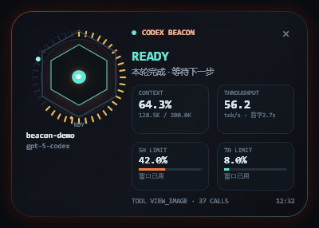

# Codex Beacon

Codex Beacon is an original Windows desktop HUD for Codex. It is a geometric signal core, not a mascot clone: a small transparent always-on-top window that shows the live state of the active Codex turn without putting a usage card into the chat reply.



> Unofficial community plugin. Not affiliated with or endorsed by OpenAI.

## What it shows

- Current Codex phase: `STANDBY`, `THINKING`, `READING`, `CODING`, `EXECUTING`, `READY`, or `ALERT`
- Context pressure as a 40-tick radar ring and exact used / limit tokens
- Approximate generation throughput and first-token latency
- Codex 5-hour and weekly subscription windows when the local account API exposes them
- Active tool name, call count, and elapsed turn time
- Short local notices from the bridge

The HUD never writes prompts, commands, reasoning text, API keys, cookies, or transcripts into its own state file. Hooks persist only session ID, turn ID, transcript path, event name, and timestamp.

The screenshot above uses an isolated demo session, not a real workspace or account.

## Requirements

- Windows 10 or Windows 11
- Codex Desktop or Codex CLI with plugin support
- Node.js 18 or newer
- Windows PowerShell 5.1 (included with Windows)

## Install

```powershell
codex plugin marketplace add qingzhh/codex-beacon
codex plugin add codex-beacon@codex-beacon
```

Restart Codex after installation so the plugin hooks and skill are loaded.

Update later with:

```powershell
codex plugin marketplace upgrade codex-beacon
```

## Use

Ask Codex:

```text
启动 Codex Beacon
```

or run the skill:

```text
/beacon
```

The launcher starts a local bridge on `127.0.0.1:17891` and opens the native WPF HUD. Drag the card to move it. Right-click for position reset, copy-status, and quit.

Stop it without opening the menu:

```powershell
node "$env:USERPROFILE\.codex\plugins\cache\codex-beacon\codex-beacon\0.1.0\scripts\launch.cjs" --stop
```

If your Codex installation uses a different plugin cache layout, run the same `launch.cjs` from the installed plugin directory.

## Local development

```powershell
cd plugins/codex-beacon
npm test
node scripts/launch.cjs
node scripts/launch.cjs --stop
```

The bridge writes only operational files under:

```text
%USERPROFILE%\.codex\plugin-data\codex-beacon\
```

## Design

Codex Beacon uses a graphite HUD, an amber signal core, mint orbit markers, a radial context ring, and compact telemetry cards. All geometry is drawn natively with WPF; the project contains no third-party mascot art or runtime art dependency.

## License

MIT. See [LICENSE](LICENSE).
